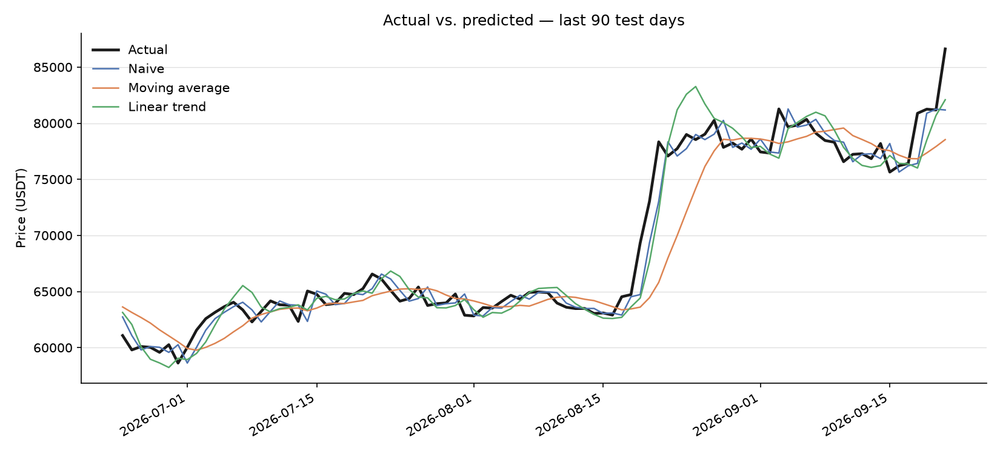

# forecast-backtester

A tool for evaluating time-series forecasting methods against a naive baseline,
using walk-forward backtesting.

**Status:** closed — v1 and v2a complete. v2b, v3 and the TA app are in the backlog.

- **v1** — price level: no method beats the naive baseline ([Findings](#findings))
- **v2a** — volatility of daily returns: the direction is right, the improvement is not
  significant ([v2a](#v2a--volatility))

---

## The question

Most forecasting write-ups report how closely a model fits the data. That is the
wrong question. The right one is:

> **Does this forecasting method do better than doing nothing?**

For a price series, "doing nothing" means predicting that tomorrow equals today —
the random-walk baseline. A model that cannot beat it has produced nothing of
value, however sophisticated it looks. This tool measures that comparison
honestly.

The first dataset is Bitcoin daily closing prices. The tool itself is not
specific to crypto, or to prices: any ordered series can be passed through it.

## Method

### Walk-forward backtesting

A single train/test split tells you how one arbitrary period happened to go. This
tool re-fits at every step instead:

```
train on days 1..t     → predict day t+1 → record the error
train on days 1..t+1   → predict day t+2 → record the error
train on days 1..t+2   → ...
```

Every prediction is made on data the model has never seen, and the result is a
distribution of hundreds of out-of-sample errors rather than a single number.

### No lookahead by construction

Every model implements the same interface:

```python
def predict(history: pd.Series) -> float:
    """Given prices up to and including day t, return a prediction for t+1."""
```

A model receives only the history available at the time of the prediction. It
cannot see the future because it is never given the future — the constraint is
enforced by the architecture rather than by care.

This matters: fitting a model on the whole series and then measuring its error on
that same series produces excellent results that mean nothing. It is the most
common failure in published price-forecasting work.

### Models

| Model | Prediction for day t+1 |
|---|---|
| **Naive** (baseline) | The closing price on day t |
| Moving average | The mean of the last N closes |
| Linear trend | A line fitted to the last N closes, extended one step |

### Metrics

- **MAE** — mean absolute error, the primary measure
- **RMSE** — penalises large misses more heavily
- **Directional accuracy** — how often the predicted direction of movement was
  correct. A model can have a respectable MAE and still be a coin flip on
  direction, which makes it useless for a decision.
- **Relative MAE** — `MAE(model) / MAE(naive)`, the headline number. Below 1 means
  the model beats the baseline; at or above 1 it does not.

Errors are also reported per calendar year, because a single overall figure can
hide a method that only works in one market regime.

## Data

Bitcoin (BTCUSDT) daily closes, three years, from the Binance public API.

The data is committed to the repository as a frozen snapshot (`data/btc_daily.csv`)
rather than fetched at run time, so that every run reproduces the same numbers.
`src/fetch.py` regenerates the snapshot when needed.

## Repository layout

```
data/              frozen snapshots: btc_daily.csv (v1, v2a), btc_hourly.csv (v2b, not run)
src/
  fetch.py         Binance API -> daily CSV (run once)
  fetch_hourly.py  Binance API -> hourly CSV, fixed window (run once)
  models.py        v1 forecasting methods
  volatility.py    v2 target series: |daily log return|
  vol_models.py    v2 volatility methods
  backtest.py      the walk-forward loop, shared by v1 and v2
  metrics.py       MAE, RMSE, directional accuracy, relative MAE
  uncertainty.py   paired moving-block bootstrap for relative MAE
  report.py        table and chart output
tests/             unit tests with hand-calculated expected values
run.py             v1 entry point
run_v2.py          v2a entry point
```

## How to run

```bash
python -m venv .venv
source .venv/Scripts/activate      # Windows; on macOS/Linux: source .venv/bin/activate
pip install -r requirements.txt
python run.py
```

`run.py` reads the committed snapshot, runs the walk-forward backtest, prints the
results table, the per-year breakdown and the bootstrap intervals, and writes
`output/predictions.png`. `python run_v2.py` does the same for v2a.

To regenerate the price snapshot from Binance:

```bash
python src/fetch.py
```

Tests:

```bash
python -m pytest
```

## Findings



**Neither method beats the naive baseline — and both lose by close to the amount
a random walk requires.**

1,065 test days, 23 October 2023 to 21 September 2026.

| Model | MAE | RMSE | Directional accuracy | Relative MAE | Random-walk expectation |
|---|---|---|---|---|---|
| Naive | 1,328.51 | 1,883.07 | N/A | 1.000 | 1.000 |
| Moving average | 2,279.96 | 3,079.92 | 50.0% | 1.716 | 1.690 |
| Linear trend | 1,808.77 | 2,412.00 | 49.8% | 1.362 | 1.309 |

### The losses are structural, not empirical

Each method here is a fixed weighted average of past prices. Under a random walk
its error variance therefore follows from its weights alone, and can be derived
without touching the data: 1.690 for the 7-day moving average, 1.309 for the
7-day linear trend.

The backtest produced 1.716 and 1.362. A paired 20-day moving-block bootstrap
(2,000 resamples, seed 42; D-021) puts the 95% intervals at [1.604, 1.831] and
[1.307, 1.421] — both containing the derived value, though for the linear trend it
sits just above the lower bound, so a small genuine excess cannot be ruled out.
`python run.py` prints these intervals.

The reading is not that these methods happened to perform badly on this series.
It is that they lose by the amount the random-walk model requires, and the series
is not distinguishable from one. There is no short-term structure here for a
smoother to extract; smoothing only carries stale information forward, and the
cost of doing so is computable in advance.

### Direction is a coin flip

Both methods predicted the next day's direction correctly on 50.0% and 49.8% of
test days. Direction is what a price forecast is usually wanted for, and on that
question both carry no information at all.

The naive baseline is marked N/A rather than 0%: predicting no change states no
direction, so the metric is undefined for it rather than failed (D-013).

### Stable across market regimes

| Year | Moving average | Linear trend | Test days |
|---|---|---|---|
| 2023 | 1.742 | 1.288 | 70 |
| 2024 | 1.781 | 1.360 | 366 |
| 2025 | 1.635 | 1.357 | 365 |
| 2026 | 1.758 | 1.381 | 264 |

Absolute error varies several-fold across these years as the price level and
volatility change. The ratios do not: they stay inside a ±5% band. The moving
average's 2025 figure is 9% below its 2024 figure, but the bootstrap intervals
for the two years overlap heavily (2024: [1.604, 1.988], 2025: [1.477, 1.812]),
so that gap is sampling variation rather than a regime effect.

### A near-zero bias is not accuracy

Mean signed error: −53 for naive, −196 for the moving average, −9 for the linear
trend.

The moving average lags the series by roughly three days, so in a rising market it
predicts low almost every day — a systematic error, visible in the chart as an
orange line that reaches August's new price level about ten days late.

The linear trend extrapolates the recent slope instead, so it overshoots rallies
and undershoots reversals. Those errors cancel in sign, leaving a bias of −9 on a
mean absolute error of 1,809. Its bias is the smallest of the three and its
accuracy is worse than the baseline's. A metric near zero is not evidence of a
good model; here it only says the errors are symmetric.

### Limits of this result

- One asset, one horizon, one window length. N = 7 was fixed by reasoning rather
  than searched (D-011), so nothing here says a different window would fail.
- Three years of daily data. A method that only works at intraday or multi-month
  frequency is not tested by this.
- The result is about *these* methods. It is evidence that the series is close to
  a random walk, not proof that no method can beat the baseline.

## v2a — Volatility

v1 asked whether the *price level* can be forecast and found that it cannot. If
the tool only ever said "no", that would say little about the tool. Volatility is
the textbook counter-case: it clusters, so calm days tend to follow calm days and
turbulent days follow turbulent ones. v2a points the same framework at it.

### Design

Fixed before the result was seen (D-017 to D-020):

- **Target:** `|r_t|`, the absolute daily log return — scale-free, unlike a dollar
  range.
- **Baseline:** the expanding-window mean of `|r|`, i.e. "volatility is a constant
  long-run level". Yesterday's value is *not* the baseline here: repeating it
  already assumes persistence, so it is a competing model.
- **Competing models**, all averaging `|r|` itself and differing only in memory:
  lag-1, a 20-day moving average, and an EWMA with λ = 0.94 (the RiskMetrics
  convention, fixed rather than searched).
- Same walk-forward loop, warm-up and headline metric as v1: relative MAE, with a
  paired moving-block bootstrap for the interval (D-021).

`run_backtest` and the metric functions were reused without a single change: v2a
needed only a new series and a new dictionary of models.

### Result

1,064 test days, 24 October 2023 to 21 September 2026.

| Model | MAE | Relative MAE | 95% interval |
|---|---|---|---|
| Expanding mean (baseline) | 0.012775 | 1.000 | — |
| Lag-1 | 0.016272 | 1.274 | [1.200, 1.336] |
| 20-day moving average | 0.012675 | 0.992 | [0.950, 1.031] |
| EWMA (λ = 0.94) | 0.012476 | 0.977 | [0.941, 1.008] |

**The ranking is the expected one, and the improvement is not significant.**

- Lag-1 is clearly worse than the baseline: a single day's `|r|` is too noisy to
  carry forward. The tool does separate methods.
- EWMA and the moving average point the right way, 2.3% and 0.8% better, but both
  intervals contain 1. With this target, this metric and three years of data, the
  improvement cannot be told apart from zero.
- The result is reported as computed (D-022). The metric, λ, the window, the
  confidence level and the period were not adjusted after seeing it.

### Why the improvement is small

`|r_t| = σ_t · |z_t|`: even a perfect forecast of the underlying volatility σ
cannot predict the day's random draw `|z_t|`, and that unpredictable part makes up
most of every model's error — in the numerator and the denominator alike. It
squeezes every ratio towards 1. This was recorded as a known limitation before the
run (D-020); it is also the standard finding of Andersen & Bollerslev (1998), who
showed that volatility models judged against daily returns look poor and the same
models judged against intraday realized volatility look clearly accurate.

### Not done: v2b

The natural next step — the same design with daily realized volatility from hourly
data as the target — is fully pre-registered (D-023, D-024) and its data snapshot
is committed (`data/btc_hourly.csv`, all structural checks passed), but it has not
been run. The project was closed before it (D-025).

## Scope

Built for version 1 (v2a reuses the same scope with a volatility target):

- One asset (BTC), daily granularity, three years of history
- One-day-ahead forecasts
- Three models including the baseline
- Results as a table, a chart and a per-year breakdown

Deliberately excluded:

- Live or streaming price data
- More than three models
- Multiple assets
- Any trading signal, position sizing or return simulation

## Not investment advice

This project evaluates forecasting *methods*. It does not predict prices and is
not intended to inform any financial decision. The expected result is that none
of the models beat the naive baseline.
